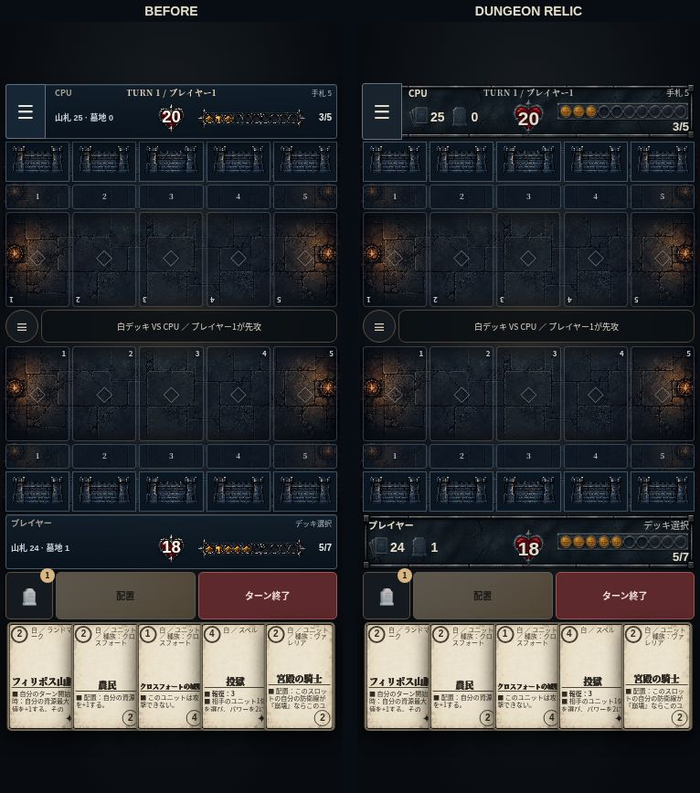

# バトルHUD — DUNGEON RELIC

2026-11-24。調査元の公開main: `3178d3ad132c6d8dbf2a1a623eaa2e82e7f82f59`。

## 調査結果と変更範囲

`index.html` の上下HUDは共通の `renderBattleHud()` / `renderResourceSlots()` で描画される。通常CPU・1台対戦・シーズン戦はこの描画を使用し、通信対戦も投影済み状態から既存の描画を呼び出す。`network/engine.js` と `network/lan.js` は `.battleHud[data-side] .life` を演出の位置取得に使用しているため、この構造を維持した。

`parchment.css` の11行グリッドと `--hud-h` が盤面全体の高さを管理している。HUDは通常56〜62px、短い画面では48pxの既存枠内で差し替えた。5レーン、壁、ランドマーク、ユニット、手札、ログ、下部操作の寸法・デザインは変更していない。

参照した既存素材:

- `assets/battle/dungeon-floor.webp`: 冷たい石畳、暗い青灰色と控えめな暖色光。
- `assets/ui/battle/defense_wall_intact.png`: 細密な石材、黒鉄、摩耗した小さな金属部品。新規生成時の主要な直接参照画像。
- `assets/cards/parchment.webp`: 既存の紙色とゲーム全体との調和を確認。
- `assets/ui/battle/life_heart.png`: 赤いハート状宝石と金属枠を継承。
- `resource_bar_10slots.png`, `resource_coin_gold.png`, `resource_empty_slot.png`: 10枠の既存判定と金貨モチーフを継承。カード裏面の専用素材は見つからなかったため、山札は同系統の黒鉄カード3枚を新規生成。

## 新規画像

保存先はすべて `assets/ui/battle/hud/`。画像生成機能で8素材を個別に制作した。すべて透過RGBA PNG、文字・数字なし。生成原画の余白・ほぼ透明な残留画素を整理し、表示用サイズへ正規化した。

| ファイル | 幅×高さ | 用途 |
| --- | --- | --- |
| hud_frame.png | 1800×268 | 傷のある青黒い鋼鉄の外装 |
| hud_life.png | 256×256 | 深紅のハート宝石と鋼鉄の盾枠 |
| hud_deck.png | 128×128 | 3枚のカードの山札アイコン |
| hud_grave.png | 128×128 | 青灰色の古い石碑 |
| hud_resource_bar.png | 1500×200 | 正確に10枠の資源装置 |
| hud_resource_filled.png | 128×128 | 使用可能な金貨 |
| hud_resource_spent.png | 128×128 | 金貨を取り除いた開放済みのくぼみ |
| hud_resource_locked.png | 128×128 | 暗い封鎖金属板の未開放枠 |

資源バーは生成原画の10枠を目視確認後、生成済みの同一ソケット部分を10回等間隔に配置し、両端も原画から組み合わせてピッチを正規化した。単純図形を代用して描いたものではない。3状態は同じ128px四方・同じ中心位置に統一。元の生成画像は保持している。

外装は黒鉄 `#080D13` / `#18232E`、石面 `#293744`、銀灰 `#65717C` / `#C6C5BF` を基調とし、LIFEの赤・金貨以外の鮮やかな色を抑えた。縮小表示では `image-rendering:auto` を使用し、細密な画素が極端に欠落するのを防いだ。

## コード変更

- `index.html`: 追加CSSの読込、山札・墓地・LIFE画像の差替え、資源の3状態を各専用画像に対応。既存ID・クラス・data-side・10枠の判定式は維持。山札と墓地は画像と数値だけにし、`title` / `aria-label` を付与した。
- `battle-hud.css`: 新規。既存CSSの後からHUDに限定して適用。フレームは9-sliceの `border-image` とし、端の金属補強を保つ。中央LIFE、左側カウント、右側資源、44px幅の上部メニュー領域を配置する。
- `network/version.js`: 既存ビルドで再生成。インライン描画ソースを含む互換性ハッシュのみの更新。通信プロトコル・同期・非公開情報の扱いは変更しない。
- `tests/battle-hud.test.cjs`: 画像の形式・寸法、既存ID、資源10枠と3状態、CPU/1台対戦/LAN投影/シーズンの共通描画、描画によるゲーム状態の不変性を検査。
- `.github/workflows/pages.yml`: 既存の通信回帰テストにHUDテストを追加。

既存の `.life` / `.hit` / `.healed` / `.wallShielded` と防衛演出の参照先を維持。`parchment.css`、`network/lan.css`、`network/engine.js`、`network/lan.js`、カードDB、AI、セーブ形式は変更していない。

## 比較画像

左が変更前、右が変更後。375×844の同一条件で、手札・LIFE・資源を揃えた表示比較用の画面。テスト用ページ・状態設定コードは公開対象に含めていない。



## 表示と動作の検証

デスクトップChromiumの実ブラウザで、各寸法のiframe内にゲームを起動して測定。iOS Safariの実機検証とは区別する。詳細値は [hud-metrics.json](screenshots/hud-metrics.json) に保存。

| 画面幅×高さ | HUD高さ | 手札の下端 | 結果 |
| --- | --- | --- | --- |
| 320×568 | 48px | 546px | スクロール不要・メニューとの重なりなし |
| 375×844 | 59.08px | 775.58px | スクロール不要 |
| 390×844 | 59.08px | 775.58px | スクロール不要 |
| 430×932 | 62px | 824.22px | スクロール不要 |
| PC 1100×900 | 62px | 807.67px | 既存の盤面幅を維持 |

全サイズで横方向のはみ出し、画像読込エラーはなし。資源バーは128〜145pxで表示され、10スロットを識別可能。`5/7` が「使用可能5・消費済み2・未開放3」になること、`0/0`、`0/10`、`10/10` もテストした。

| 確認内容 | 実施結果 |
| --- | --- |
| 通常CPU戦 | 実際のターン終了からCPU配置まで確認 |
| 1台対戦 | ターン交代と上下HUDのプレイヤー切替を確認 |
| シーズン戦 | イベント条件でのHUDとHP表示を確認 |
| LIFE減少・回復 | 実際の `changeLife()` で数値更新、hit / healedの発火を確認 |
| 防衛線の保護演出 | 既存 `showDefenseShield()` とwallShieldedの発火を確認 |
| 資源、山札、墓地 | 値更新、3状態、山札減少・墓地増加を確認 |
| 戦闘メニュー・墓地閲覧 | 既存ボタンで開閉し、墓地カード内容を表示 |
| 通信対戦 | LAN投影状態の共通HUD描画テスト、既存24件の通信回帰テスト成功 |

実行した回帰確認:

```sh
npm run build:network
node --test tests/battle-hud.test.cjs
npm run test:network
node tests/ai-regression.cjs
node tests/placement-regression.cjs
node tests/deck-editor-regression.cjs
node --test tests/blue-set3.test.cjs tests/season-score-regression.cjs tests/moon-god-regression.cjs
```

HUD4件、通信24件が成功。その他、CPU19・配置19・デッキ編集36・青第3弾18・シーズンスコア37・月神77の既存チェックも成功した。ゲームルール・AIの変更はない。

未検証: iPhone/Android実機、Safari固有のセーフエリアとアドレスバー開閉、実端末2台間のWebRTC通信対戦、新HUDでのシーズン全3連戦の完走。通信対戦は描画経路と回帰テストを確認しており、今回の作業で実機対戦を実施したという意味ではない。

## 画像の再生成情報

主要参照は `defense_wall_intact.png`。床・既存ハート・資源素材の色彩と縮小時の見え方を併せて確認。共通スタイル指定:

```text
Production-ready CROSSFORT dark medieval underground fortress UI sprite.
Fine-grained detailed pixel art matching supplied defensive stone wall reference.
Cold blue-black iron #080D13 #18232E, slate #293744, subtle silver-gray
#65717C and #C6C5BF, only tiny aged bronze #8B7961.
Practical compact heavy aged metal, front-facing orthographic shallow depth,
crisp pixel clusters not oversized blocks, low saturation and restrained
light from upper left. Genuine transparent PNG background, clean alpha edges,
tight silhouette. No text letters digits scenery, no royal decorations wings
crowns banners statues, no neon or excessive shine, no smooth vector or
photorealistic 3D.
```

素材ごとに加えた制作上の指定:

| 素材 | 個別の形状・用途指定 |
| --- | --- |
| frame | Very wide low-profile worn steel HUD frame; quiet dark flat interior, small reinforced corners, no embedded icons or slots. |
| life | Deep crimson heart-shaped gem inside a compact blue-black steel shield, thin silver rim, quiet dark center for a number overlay. |
| deck | Three overlapping blue-black card backs, restrained silver edges and small geometric engraving, no pedestal. |
| grave | Old blue-gray stone grave marker, defensive-wall stone texture, small cracks and subtle geometric ancient carving. |
| resource_bar | Wide cold iron resource rail, exactly ten evenly spaced empty circular sockets, thin silver rim, no coins. |
| resource_filled | Readable antique gold coin with ancient geometric engraving, no letters or digits. |
| resource_spent | Open empty blue-black circular metal socket, visible recessed interior and thin rim. |
| resource_locked | Same circular footprint and rim, sealed with a dark cold metal cover, darker than the open spent socket, no glow. |

生成後の技術調整: アルファの余白整理、中心揃え、PNGサイズ正規化、資源バーの反復間隔調整。画像の文字・数値は生成せず、ゲーム内で従来どおり動的に重ねる。
