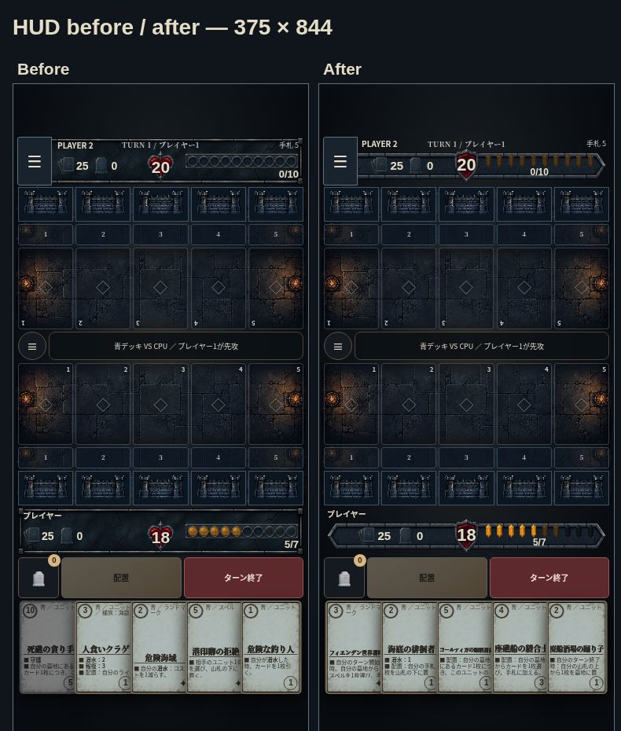

# Integrated Dungeon Relic HUD — 2026-11-25

## Scope and source review

Base: `2e46fc559f47c4aa39854421ab63bb99db1bb85c` on main. Started from a fresh clean clone; previous task checkouts were left untouched. Reviewed index.html, battle-hud.css, parchment.css, network/lan.js, network/lan.css, network/engine.js, dungeon-floor.webp, parchment.webp, defense_wall_intact.png and the existing HUD sprites. Shared renderBattleHud/renderResourceSlots are reached by LAN renderView through base.render. The life animation anchors and data-side remain unchanged.

The previous nine-slice rectangular background left the crest floating independently. This revision replaces that background with two generated angular rails overlapping 15px behind the central shield. The outer 20px rail endcaps remain fixed via border-image slicing; middle panels stretch. The crest uses object-fit:contain, z-index:2 and the existing life anchor. Resource sprites are independent vertical crystals in exactly ten existing slots. The obsolete frame and circular resource-bar images remain available but are no longer drawn. Existing deck/grave icons are unchanged.

## Images and provenance

Built-in image generation produced a complete concept first, using the user-provided silhouette reference plus existing wall/floor images. Separate rail, shield, available crystal, spent crystal and locked crystal were then generated using that concept and crystal as direct references. The right rail is a mirrored copy of the generated left rail to guarantee matching geometry and texture. Cropped low-alpha margins, resized the production sprites, darkened the locked material and unified crystal alpha masks. All final files are RGBA transparent PNG, without text/numbers. No CSS/SVG placeholder decorations were used.

All saved under `assets/ui/battle/hud/`:

| File | Dimensions |
| --- | --- |
| `hud_wing_left.png` | 1000 × 180 |
| `hud_wing_right.png` | 1000 × 180 |
| `hud_life_crest.png` | 209 × 280 |
| `hud_resource_filled.png` | 52 × 128 |
| `hud_resource_spent.png` | 52 × 128 |
| `hud_resource_locked.png` | 52 × 128 |

Reused: hud_deck.png and hud_grave.png. Old hud_frame/hud_life/hud_resource_bar files are retained for compatibility/history, not used by the new HUD.

## Changed files

- battle-hud.css: integrated rails, central shield, crystal layout, name truncation, existing menu reserve and short-height behavior. No other screen selectors.
- index.html: crest image paths, CSS v2 cache query, crystal v2 cache query. Existing IDs, classes, state and filled/spent/locked decisions are unchanged. The previously hidden backBattleBtn stays hidden.
- six production PNG sprites (three new, three replaced).
- network/version.js: regenerated existing inline-render-source hash only; network logic/protocol unchanged.
- tests/battle-hud.test.cjs: production image dimensions updated for the new shapes, existing HUD/renderer checks retained.
- this report and three screenshot/measurement evidence files.

## Validation

Chromium browser iframe viewport measurements (not physical device testing):

| Viewport | HUD height | Overflow / slots |
| --- | --- | --- |
| 320 × 568 | 48px | No page scroll, 10 |
| 375 × 844 | 59.08px | No page scroll, 10 |
| 390 × 844 | 59.08px | No page scroll, 10 |
| 430 × 932 | 62px | No page scroll, 10 |
| 1100 × 900 | 62px | No page scroll, 10 |
| 390 × 568 | 48px | No page scroll, 10 |

All measured sizes: no overlapping HUD columns, no failed game image loads. The short-screen crest fits inside 32px stats height. Full results: screenshots/integrated-metrics.json. Function results: screenshots/integrated-functional.json.

Real browser fixture exercised actual changeLife damage/heal and hit/healed classes; showDefenseShield/wallShielded; deck decrement and grave increment; grave modal opening; menu opening; long-name clipping; local turn swap; CPU turn completion; and season-mode start (stage 1, configured HP). All passed. Game page JavaScript errors were not observed; the browser extension logged unrelated metadata errors. Test-only fixture state/setup is excluded from the published repository.

Automated: HUD 4 + LAN 24 tests passed; AI 19, placement 19, deck editor 36, blue set 18, season score 37 and moon-god 77 existing assertions passed. Network vendor build succeeded. Network logic, AI, card rules, saving, board, hand and controls are unchanged.

Unverified: physical iPhone/Android and Safari safe areas/address-bar transitions, real two-device WebRTC session and new-HUD season three-stage full run. LAN renderer mapping and serialized two-client engine/reconnect behavior are covered by existing tests, not a claim of physical network play. Connection status banner logic and positioning are unchanged; live reconnection-banner visual testing was not performed.

## Comparison

Left before, right after, 375 × 844. Fixture hands differ due to shuffled decks; only HUD code is changed.

## Generation prompts

Shared: Production CROSSFORT UI sprite, fine detailed pixel-art density matching the defensive wall, cold worn blue-black iron #0B131C #182632 #30414F, restrained silver-gray #81909A highlights, upper-left light, transparent background, no text/numbers/scenery/glow/vector gradients/gold exterior. User reference for silhouette only.

- Complete concept: angular cut outer rails joining behind a taller central shield with quiet crimson gem; left deck/grave icons; right exactly ten amber/bronze/slate vertical crystals. No numerals; dynamic values supplied in HTML.
- Rail: empty wide left rail, angular outer bevel, straight horizontal edges, flat connector at shield, no icons or slots. Mirror for right.
- Crest: isolated central pointed shield, blue-black thin silver frame, large quiet dark crimson gem face; no heart silhouette or ornament.
- Available crystal: one vertical hexagonal amber crystal, subtle facets, warm gold #D3A443, no emitted glow.
- Spent/locked: preserve crystal silhouette/facets/placement, change only material to dull dark bronze / darkest cold blue-black slate. Normalize alpha and dimensions after generation.
