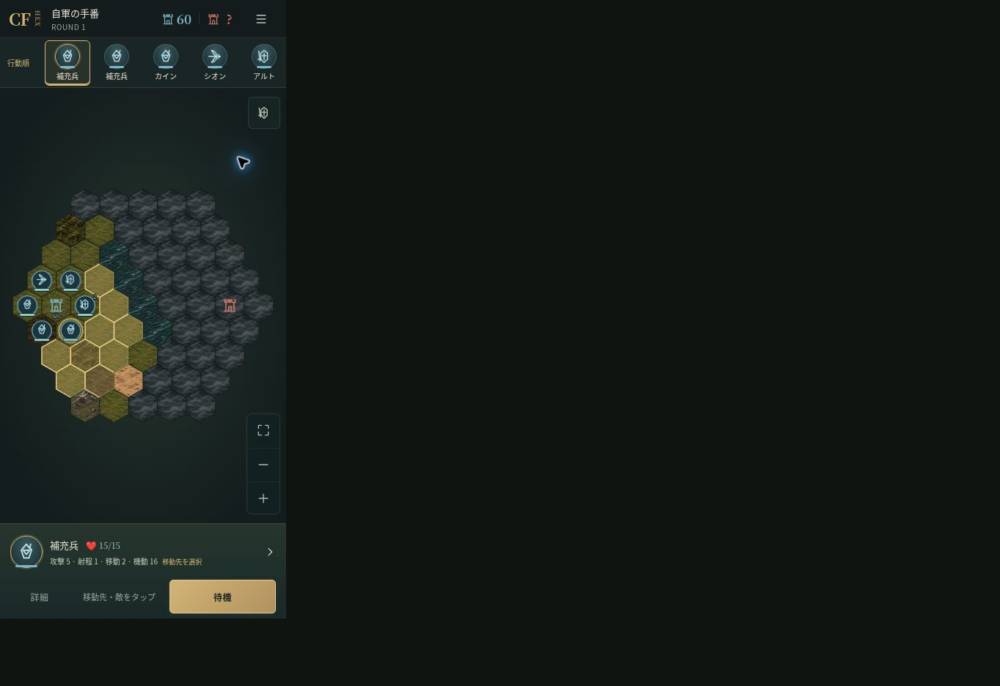

# 勝利後の編成枠修正（2026-11-09）

## 原因と修正

勝利確定で戦死者は所持一覧から正しく除外されていましたが、画面側の編成ID配列に残っていました。コストと出撃アイコンは所持一覧を参照し、人数と追加時の検証は古い配列を参照するため、「1名しか見えずコスト2なのに6/6」となっていました。

所持データを画面へ受け取る共通処理で、編成・配置・配置選択を一緒に整合させます。現役所持一覧に存在しないIDと重複だけを除き、生存者の順序・配置・選択は保持します。初回読込、Workerからの再開、勝利報酬確定、除隊、補充、名前変更の保存を同じ経路で扱います。加入兵は自動編成しません。

戦闘ルール、永久喪失、成長、報酬、IndexedDBの保存形式は変更していません。既存セーブの初期化や移行は不要です。旧版の画面を再読み込みすれば新しいコードを利用できます。

## 自動検証

- `character-formation-ui.test.tsx`: 5名戦死後の人数1/6・コスト2/10・空き5枠、配置数の一致、控え追加、除隊、順序維持、重複ID整理、冪等性、保存データ非変更（6テスト）。
- `character-formation-lifecycle.test.ts`: 実際のIndexedDBで勝利報酬を確定・再読込し、戦死5名をアーカイブ、生存者の成長・戦績を保持。補充後に6名で次戦を開始し、保存した戦闘の復元まで確認（1テスト）。
- `npm run typecheck` / `npm run lint` / `npm test` / `npm run build`: 成功。全29ファイル・336テスト。既存のCPU108条件も未決着0。

## 実画面確認

開発専用の `/qa/formation-recovery.html` で、本番と同じ `useCharacterGame`、編成画面、配置バー、勝利報酬保存処理を使用して確認しました。この検証ページはVite開発時のみ利用し、公開ビルドには含めません。

1. 騎士2・弓兵2・斥候2を選択：編成6・実体6・コスト10。
2. 「6名中5名戦死の勝利を確定」：編成1・実体1・コスト2・戦死5。出撃表示も1/6。
3. 斥候2名を無料補充し、控え3名とともに追加：編成6・実体6・コスト9。
4. 配置へ進み、隣接マスへ配置して戦闘開始：実Workerが自軍6名で開始。
5. 通常画面へ遷移して保存から再開：ROUND 1、自軍6名、本城HP60、未視認の敵本城HPは「?」。390×844 CSSピクセルでページの縦横はみ出しなし。

検証ページの勝利ボタンは人工的な生死結果を用いるUI回帰確認です。実戦のルール・CPU完走は既存のセッション／Worker／CPU結合テストで別途確認しています。スマホ実機検証は未実施です。

右側の暗い領域は検証ブラウザの余白です。左側のゲーム領域は390×844 CSSピクセルで確認しています。
