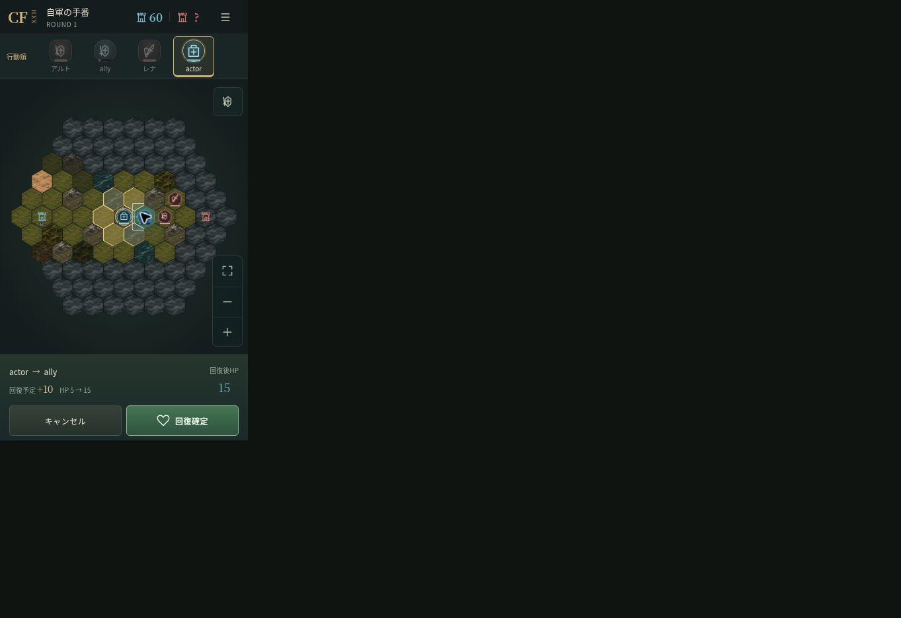
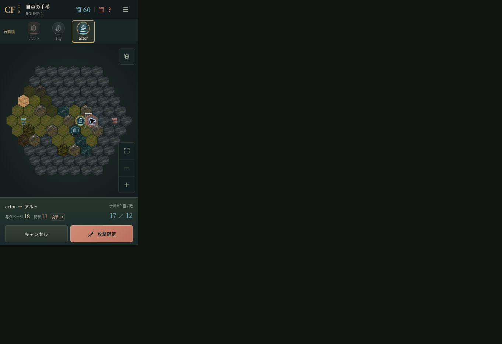
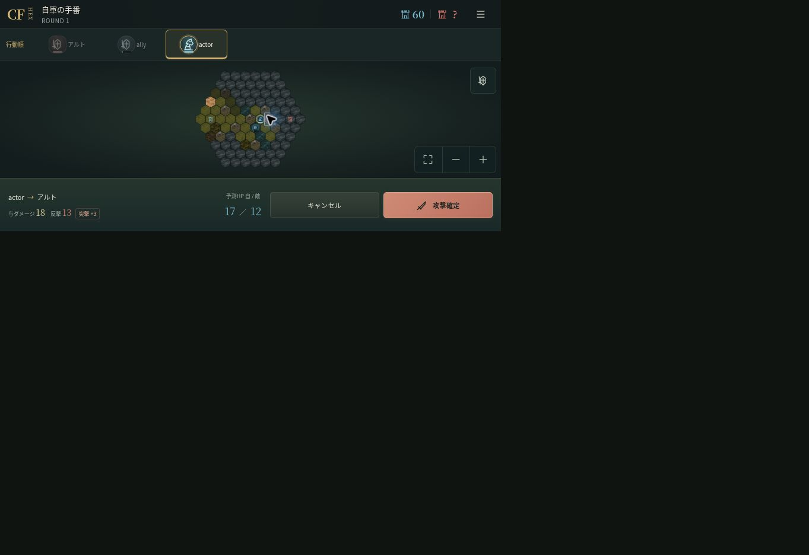
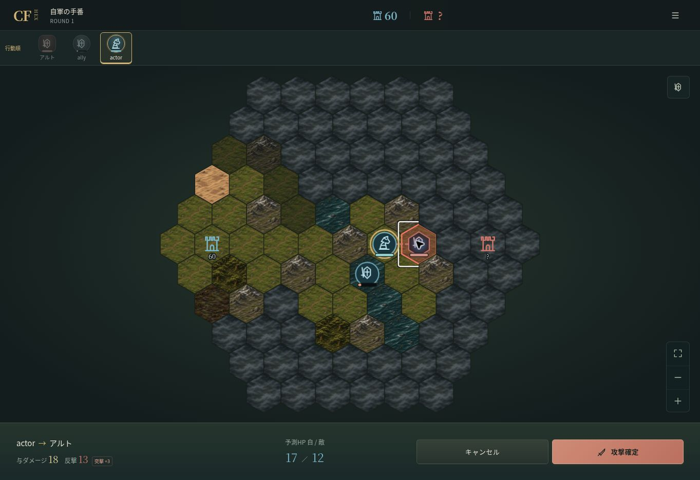

# 新職業3種追加 v2.2 — 実装・検証（2026-11-09）

## 実装内容

| 職業   | 追加した行動・表示                                                                                                                 |
| ------ | ---------------------------------------------------------------------------------------------------------------------------------- |
| 槍兵   | 射程2、基礎反撃×1.2。既存の通常攻撃・地形・成長を利用                                                                              |
| 衛生兵 | 隣接する生存味方1名を攻撃値×1.2・四捨五入で回復。自身・敵・死亡者不可。毎ラウンド使用可。最大HPまで。攻撃・反撃不可、反撃成長0固定 |
| 騎兵   | 移動3、実際に3マス移動した同じ行動の対兵士攻撃のみ+3。反撃・本城攻撃へ加算しない。待機・行動終了で失効                             |

6職の基礎値は `ruleset.characters.json`、行動特性は同ファイルの `abilities` に定義。既存3職の数値は維持。回復・突撃補正・反撃は独立した純粋関数に分割しています。回復は専用合法手と緑の構造化演出、突撃は金色の短い踏み込みと「突撃」表示を使います。ダメージや対象を文章から推測しません。

6職業のアイコン、一覧の絞込、補充、兵士詳細の能力説明、予測、行動順、ヘルプ、成長、スカウト、永久喪失に対応。人数は実際の選択兵士数から表示し、保存更新時の編成ID整合処理を継続しています。

新職業は新規CPUの降伏兵からの勧誘、および所持6名未満の無料補充で獲得できます。初期9名は騎士・弓兵・斥候各3名を維持し、既存所持兵士へ自動追加・職業変更は行いません。新規CPU編成はデータ定義5パターンからseedで選択し、5〜6名・コスト10を守ります。この出現構成は暫定値です。

## 保存互換性

schemaVersion 3と既存IndexedDBを維持。既存ID・名前・所属・個体差・成長履歴・戦績・報酬を再抽選しません。新規対戦だけ `encounterVersion=2` を記録し、旧対戦の未指定値は1として旧CPU兵士を再現します。進行中の旧対戦も復元可能です。

騎兵の移動確定後のマス数を戦闘スナップショットへ保存し、リロード後の同じ行動でも突撃判定を維持。相手の未公開移動距離は観測へ含めません。回復もWorker内で確定・保存してから表示し、保存失敗時は既存の操作前復元を使用します。勧誘と成長の一括報酬処理・二重取得防止も維持しています。

## テスト結果

`npm run typecheck` / `npm run lint` / `npm test` / `npm run build` はすべて成功。全35ファイル、402テスト（追加66）。

- 基礎値、槍兵の距離2/3、反撃倍率、地形計算順序。
- 衛生兵の回復10/11/12、成長値参照、最大HP、味方衛生兵、自身/敵/死亡/射程外拒否、複数ラウンド、行動終了、反撃0、MAXまでの3成長。
- 騎兵の移動0/1/2/3、二段階・一括攻撃の突撃、待機失効、反撃・本城へ非適用、地形制限、中断経路、移動後セーブ復元。
- 実Workerで回復・3マス移動・再開・攻撃を処理し、構造化演出と確定HPを照合。視野外CPUの回復・対象ID・移動距離を公開しない。
- 実IndexedDBで旧兵士・旧戦闘を復元。新職の補充・スカウト・成長・死亡除外・次戦編成・再読込・二重報酬拒否を確認。
- 既存の勝利後「1名なのに6/6」回帰テストを維持。
- 既存3職108条件は全決着、前版と同じ集計（6対6の36条件は20勝/16敗）。
- 新職を含む編成で全6マップ×4シードの24条件は全決着（4〜13ラウンド、回復計107回、片側9勝/相手15勝）。数値の独自調整はしていません。

## 実画面確認

Vite開発専用 `qa/new-classes.html` から、実際の保存関数を通じて検証用兵士と戦闘を準備し、通常のCharacterAppとWorkerで操作しました。検証ページは公開ビルドに含みません。

- 375×667：敵タップで回復・攻撃を実行しないこと、味方タップ→回復予定+10・HP5→15→回復確定、実HP15への更新。
- 375×667：騎兵の経路3マス→順次移動→突撃可能+3→予測18・反撃13・HP17/12。リロード後も同じ突撃予測。
- 回復選択・突撃予測の前後で `data-camera` の座標と倍率が一致。
- 390×844：通常の無料補充で衛生兵・槍兵を加入させ、騎兵・騎士と4名を選択。編成4/6・コスト9/10。実マップへ4名を配置し、新規対戦を開始。自軍行動順は騎士10→槍兵9→衛生兵8→騎兵5。
- 430×932、844×390、768×1024、PC1363×936：ページのscrollWidth/scrollHeightが各clientWidth/clientHeightと一致。不要なページスクロールなし。
- PCでも予測18・反撃13を確認し突撃を実行。検証用の少人数戦で敗北結果と所持データの巻戻しも確認。

### 確認画像

画像の暗い余白は検証ブラウザの外側です。各CSS画面サイズは上記のDOM寸法で測定しています。画像のactor/allyは開発専用の検証兵士名です。

## 未実施・残課題

iPhone/Androidの物理端末での検証は未実施です。ブラウザと自動テストで未解決の機能不具合は確認されていません。CPU編成の出現構成は設定値として変更でき、長期の職業バランス評価は今回の24条件を初期資料とします。

## 変更ファイル

- `games/hex/BUILD_INFO.json`
- `games/hex/README.md`
- `games/hex/data/ruleset.characters.json`
- `games/hex/docs/GAME_SPEC.md`
- `games/hex/docs/NEW_CLASSES_ACCEPTANCE.md`
- `games/hex/docs/screenshots/classes/charge-desktop.png`
- `games/hex/docs/screenshots/classes/charge-landscape.png`
- `games/hex/docs/screenshots/classes/charge-mobile.png`
- `games/hex/docs/screenshots/classes/heal-mobile.png`
- `games/hex/package-lock.json`
- `games/hex/package.json`
- `games/hex/qa/new-classes.html`
- `games/hex/qa/new-classes.ts`
- `games/hex/src/app/CharacterApp.tsx`
- `games/hex/src/app/battle-target.ts`
- `games/hex/src/app/character.css`
- `games/hex/src/app/useCharacterGame.ts`
- `games/hex/src/character/abilities.ts`
- `games/hex/src/character/battle.ts`
- `games/hex/src/character/combat.ts`
- `games/hex/src/character/cpu.ts`
- `games/hex/src/character/encounters.ts`
- `games/hex/src/character/growth.ts`
- `games/hex/src/character/presentation.ts`
- `games/hex/src/character/reward.ts`
- `games/hex/src/character/roster.ts`
- `games/hex/src/character/session.ts`
- `games/hex/src/character/types.ts`
- `games/hex/src/character/validation.ts`
- `games/hex/src/components/character/CharacterBoard.tsx`
- `games/hex/src/components/tactics/BattleActionBar.tsx`
- `games/hex/src/components/tactics/CampScreens.tsx`
- `games/hex/src/components/tactics/Icons.tsx`
- `games/hex/tests/class-session-helpers.ts`
- `games/hex/tests/integration/character-new-class-storage.test.ts`
- `games/hex/tests/integration/character-new-class-worker.test.ts`
- `games/hex/tests/integration/character-six-class-battles.test.ts`
- `games/hex/tests/new-class-helpers.ts`
- `games/hex/tests/unit/character-class-actions.test.ts`
- `games/hex/tests/unit/character-class-presentation.test.tsx`
- `games/hex/tests/unit/character-new-classes.test.ts`
