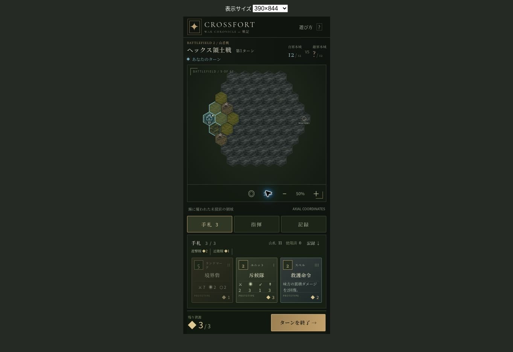
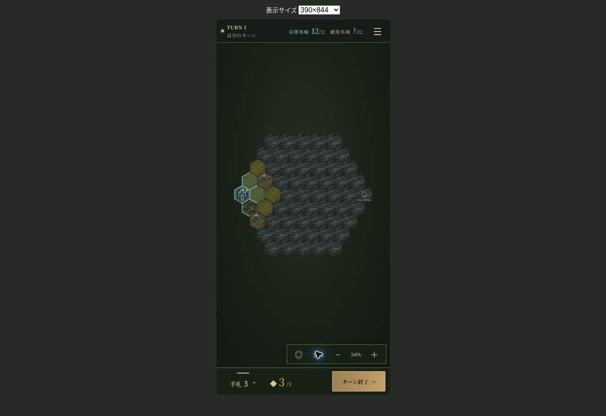
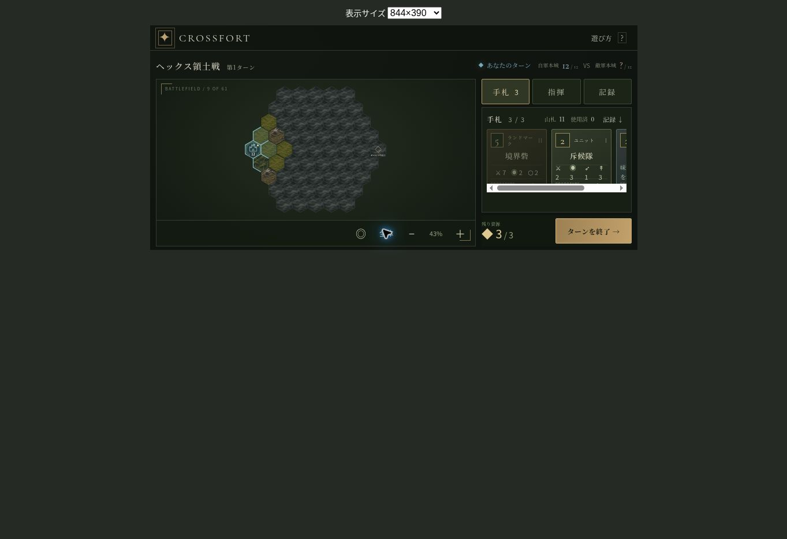
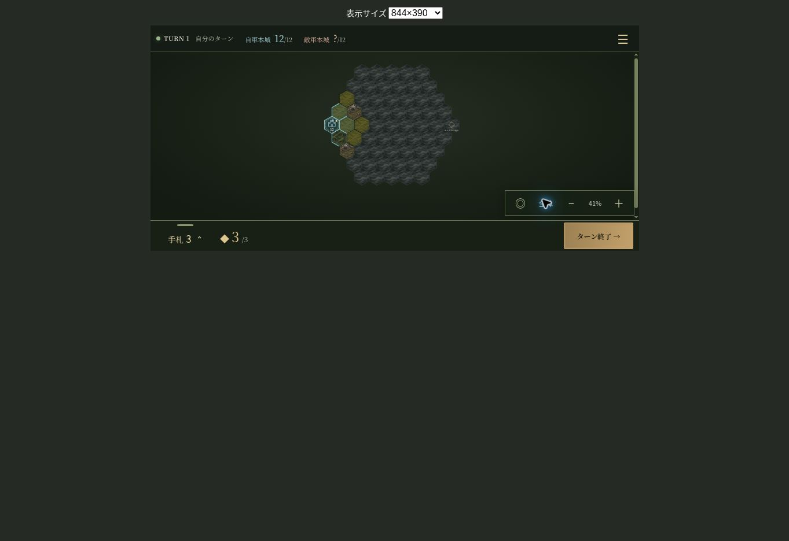
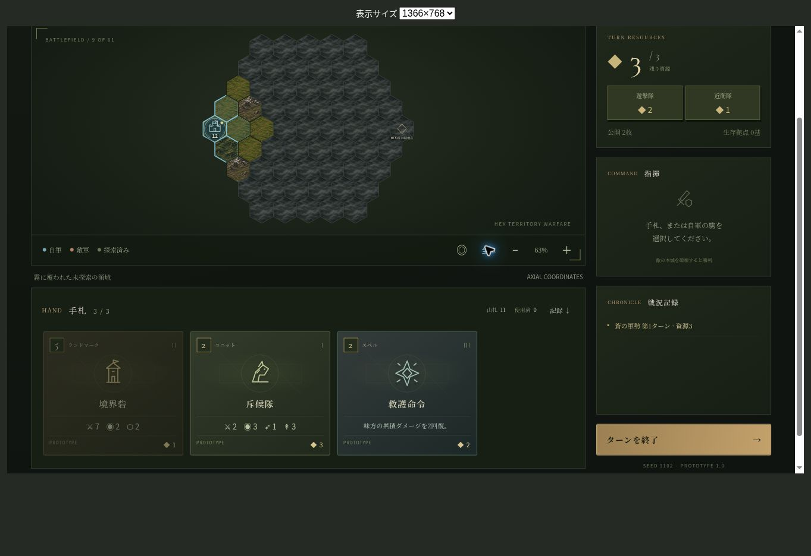
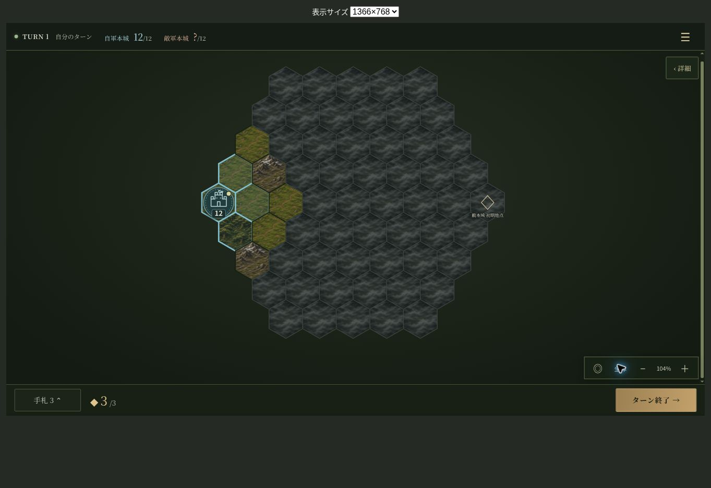

# 戦闘画面 UI 改修 — 2026-11-02

マップを主役とし、固定タブを廃止。初期状態は手札・資源内訳・戦況記録・サイドバーをすべて収納します。ゲームルール、カード効果、CPU判断は変更していません。

## 変更ファイルと責務

| ファイル | 変更内容 |
| --- | --- |
| `src/app/App.tsx` | 既存の選択・確認・Worker操作を新レイアウトに接続。無効化されたカード/駒の選択解除。長文パネルと強制タブ移動を撤去 |
| `src/app/style.css` | 旧パネル・見出し・段組み用の未使用CSSを撤去 |
| `src/app/responsive.css` | 共通のタッチ操作・セットアップ・ダイアログに整理 |
| `src/app/battle.css` / `src/main.tsx` | dvh/Safe Area、盤面の伸縮、軽量通知、トレイ、3段階ドロワー、横画面、低モーションのスタイル |
| `src/components/Board.tsx` | 装飾的な英語見出しを撤去。既存の駒・経路・配置/攻撃範囲・スクロールを維持。低モーション時のカメラ移動を即時化 |
| `src/components/Card.tsx` | 手札トレイ用のコンパクト表示を追加 |
| `src/components/battle/` | `BattleHeader`、`BattleLayout`、`MobileBottomDrawer`、`DesktopSidebar`、`HandTray`、`SelectionInspector`、`ResourceSummary`、`ChroniclePanel`、`DetailPanels`、開閉専用reducerに分離 |
| `tests/unit/battle-ui.test.tsx` | 開始時収納、単一アコーディオン、収納時の項目保持、スワイプ段階、閉じた本文の除去、公開ルール、短いガイドを8件で検証 |
| `README.md` / `BUILD_INFO.json` / `docs/VALIDATION.md` | 操作と検証記録を更新 |
| `hex/index.html` / `hex/assets/` | 公開用のビルド済みファイル |

## 表示と操作

- ヘッダーは手番、ターン、本城の戦力、メニューのみ。視野外の敵本城は `?` のままです。
- スマホのドロワーは収納が初期値。半開きは画面高の約32%（横画面34%）、全展開は約68%。本文だけがスクロールします。
- タップ/ハンドルの上下ドラッグ/矢印キーで展開・収納。全展開中に指示を選んでいない場合、盤面タップでも収納します。指示がある場合は盤面操作を優先します。
- PCのサイドバーは閉じるとDOMから外れ、300pxを実際に盤面へ戻します。詳細項目は同じボタンで再収納でき、同時に1項目だけ開きます。
- カード/部隊/経路はAppに、開閉状態は表示用reducerに保持。開閉によってゲーム上の選択を変更しません。PC/スマホ間でも選択と経路は共通です。
- 選択中だけ簡易情報・交換・移動確定を表示。ターン終了は移動経路の選択中も独立したボタンとして残します。攻撃/移動/配置は従来の確認処理を通します。
- 頻繁な回収・移動・資源抽出には大型通知を出さず、戦闘/撃破/発見/スペルのみ短い非遮断表示。長文履歴は収納した記録へ移動しました。
- 本文を収納するとフォーカス可能な子要素も外れます。Esc収納時はハンドル/開閉ボタンへフォーカスを戻します。開閉に `aria-expanded`、適切なラベルを付けています。

## サイズ検証

Chromiumの同一オリジンフレームで実際のCSS viewportを設定して確認。以下は未選択・すべて収納時のマップ領域（CSS px）。全サイズで文書のscrollWidth/scrollHeightがviewportと一致しました。

| 画面 | マップ領域 |
| --- | --- |
| 375×667 | 375×554 |
| 390×844 | 390×731 |
| 430×932 | 430×819 |
| 844×390 | 844×292 |
| 768×1024 | 768×911 |
| 1366×768 | 1366×653 |
| 1440×900 | 1440×785 |

390×844のマップ高は改修前363pxから731pxへ増加。1366×768ではサイドバー展開時の幅1066px→収納時1366pxを確認しました。ドロワー全展開時の高さは375×667で454px、390×844で574px、430×932で634px、844×390で265px、768×1024で696px。各画面の70%以内で、横はみ出しはありません。

## 実操作と自動試験

| 検証 | 結果/方法 |
| --- | --- |
| 手札選択→収納→配置 | 390×844で選択後も3つの配置候補を保持し、確認後に斥候隊配置・資源3→1・視野拡大を確認 |
| 部隊選択→経路→開閉→移動 | 375×667で斥候隊の移動候補22マス、全展開/収納を挟んでも経路のSVG座標が同一。確認後に-3,0→-2,0へ移動 |
| 手札交換 | PCで斥候隊→騎兵隊へ交換。交換済ボタンが無効化されることを確認 |
| ランドマーク建設 | 山岳戦seed87で民兵隊→隣接マスへ監視塔を建設。既存の確認処理と資源支払を確認 |
| 開閉とキーボード | 3段階の全サイズ検証、ハンドルのドラッグ、ArrowUp、Esc収納、フォーカス復帰、PCの単一アコーディオンと横幅解放 |
| CPU操作制限 | CPU手番のターン終了ボタンは無効。自分の次ターンで手札と資源が更新 |
| 戦闘・反撃・領土・秘匿 | 既存の単体/回帰テストを継続実行 |
| 勝利/敗北/再戦 | CPU完走・複数シード・実Worker境界の既存結合試験で、本城破壊による決着と同条件再戦を検証 |
| 型・lint・build | `npm run typecheck`、`npm run lint`、`npm test`（95件）、`npm run build` |

`src/game/`全体、`src/app/game.worker.ts`、`src/app/protocol.ts`、ルール/カード/マップ/演出調整JSONは改修前と同じ内容です。Workerの公開ビルドも `game.worker-BvxZ_qzQ.js` のままです。

実機iOS/Androidでのマルチタッチ、OSが確保するノッチ領域、実ブラウザのアドレスバー伸縮はこの実行環境では直接検証していません。CSSは既存のネイティブpan/pinch操作を保持し、`dvh` / `safe-area-inset-*`を使用しています。

## 改修前後のスクリーンショット

山岳戦・先攻・seed1102・第1ターン。各サイズで「全体」を押した状態。画像はブラウザから取得した原本です。検証フレームを表示する外側の背景も含みます。

| サイズ | 改修前 | 改修後 |
| --- | --- | --- |
| 縦390×844 |  |  |
| 横844×390 |  |  |
| PC1366×768 |  |  |
